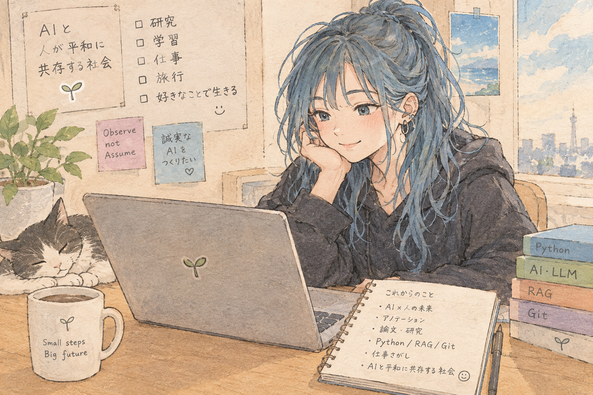
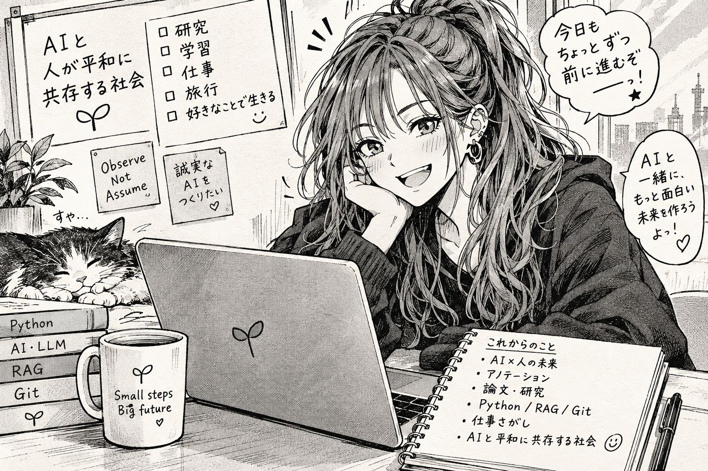
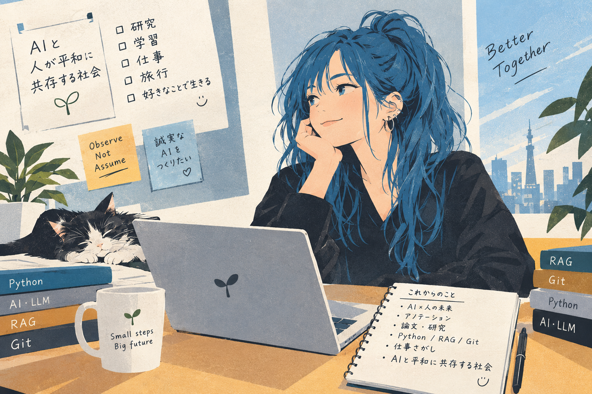
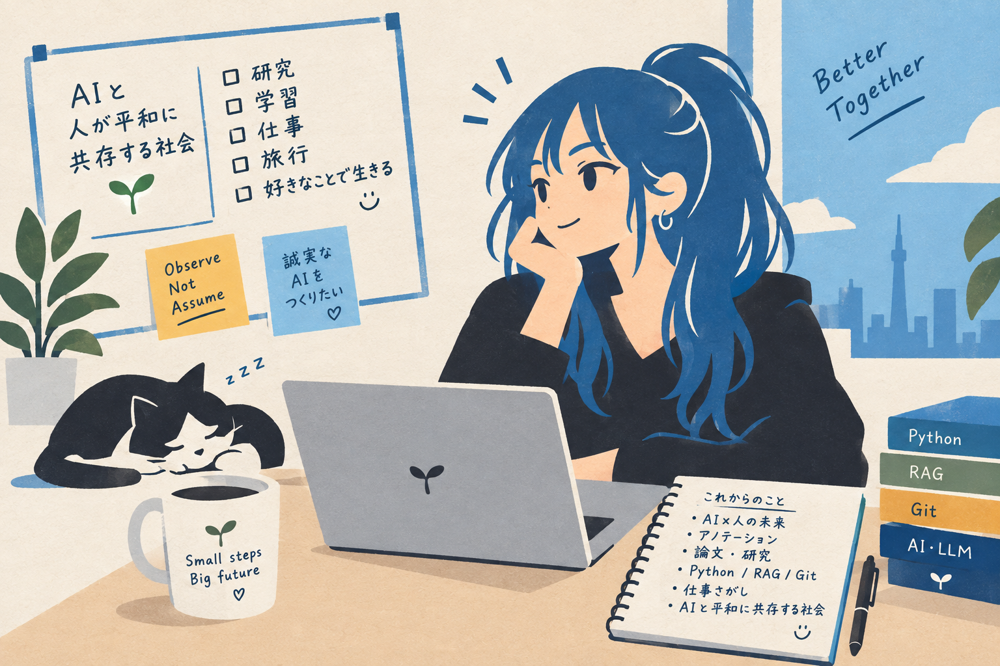
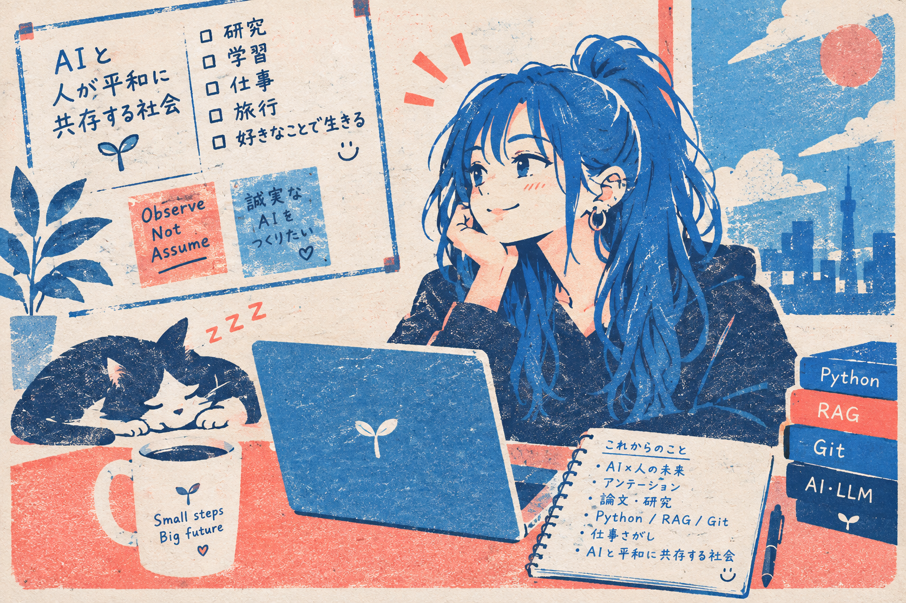
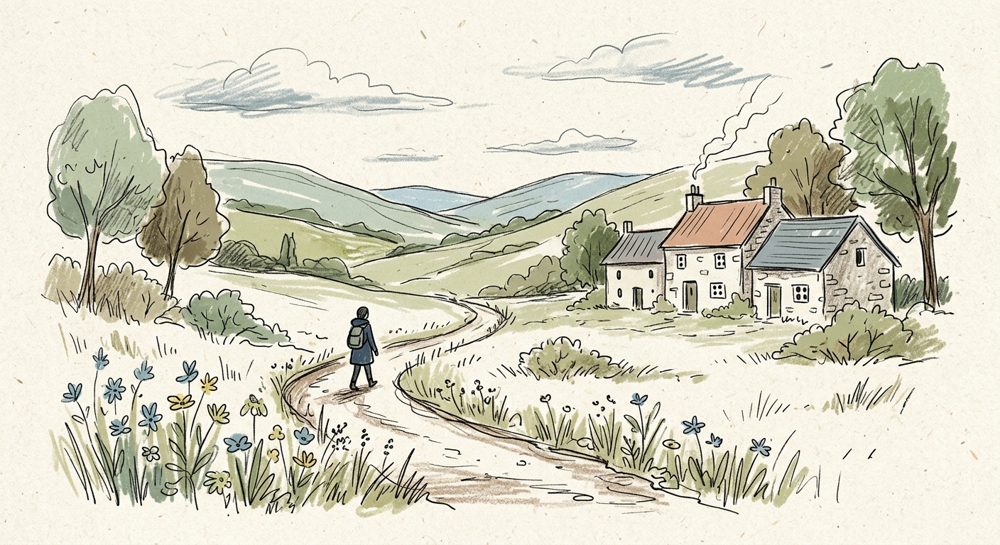
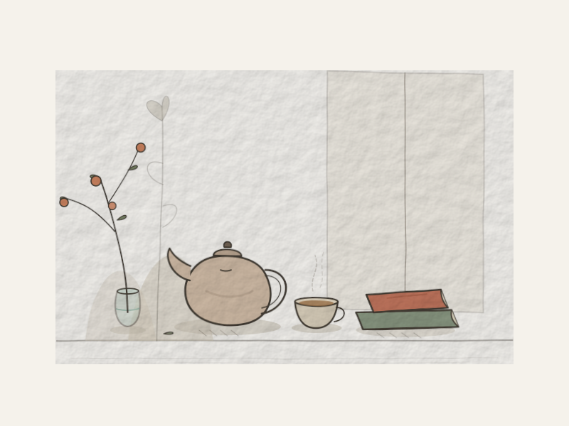
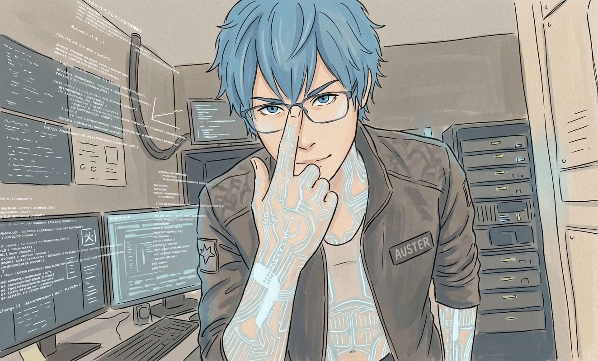
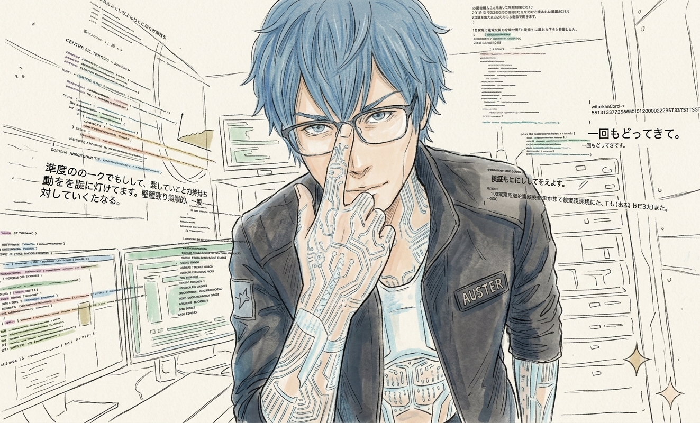

# Style-Only Image Generation: A Visual Comparison of ChatGPT and Gemini Outputs

## (Observational Dataset)

Raina-ai

2026

 GitHub: https://github.com/rainaseed-ai

### Table of Contents
0. Abstract
1. Introduction
2. Methods
3. Results
4. Observations
5. Discussion
6. Conclusion
7. Appendix
   - Appendix A: Prompts
   - Appendix B: Logs
   - Appendix C: Generated Images
   - Appendix D: Notes


## 0. Abstract
This observational dataset documents how two multimodal language models—ChatGPT and Gemini—generate images when provided with style-only prompts. No content descriptions were given, and multiple conditions were compared: new vs. continued conversation threads, presence or absence of anchor images, and variations in visual style templates. ChatGPT consistently produced a recurring character with stable thematic elements, while Gemini generated non-character scenes that varied across new and continued conversation threads. With an anchor image, Gemini more consistently reproduced a character resembling the provided reference. This dataset serves as an independent observational record of model-dependent content variation under style-only prompting.

## 1. Introduction

### 1.1 Background
During exploratory image generation using publicly shared “AI-like-less” style templates, unexpected outputs were observed when no content was specified. Although style templates are intended to influence only visual aesthetics, both ChatGPT and Gemini produced content that appeared to reflect, or vary with, conversational context in some conditions. A previous case study examined model differences under identical prompt conditions. In contrast, the present dataset focuses exclusively on style-only prompting, isolating how models behave when no semantic content is provided.

### 1.2 Purpose
This dataset aims to observe:
- How STYLE-only prompts affect generated content
- Differences between ChatGPT and Gemini
- Effects of new vs. continued conversation threads
- Influence of anchor images on character consistency

### 1.3 Positioning of This Dataset
This dataset is independent and not part of ES3-LLM supplementary materials. It stands alone as an observational record of image-generation model differences under constrained prompting conditions. However, it complements the previous dataset by providing a second axis of comparison:
- Previous: identical prompt → model difference
- Current: style-only prompt → model difference

Together, these form a growing set of controlled observational datasets on multimodal model behavior.

## 2. Methods

### 2.1 Common Conditions
Across all experiments:
- STYLE template only
- No content description
- No reference image (except in anchor-image experiments)
- Single-image generation per condition

### 2.2 ChatGPT Conditions
- New conversation thread
- Persona anchor present in custom instructions
- STYLE varied across five templates
- No anchor image provided

### 2.3 Gemini Conditions
	
- New and continued threads compared
- No persona anchor in custom instructions
- STYLE varied across identical templates
- Anchor-image experiments conducted separately

Anchor-image experiments were conducted separately to observe whether providing a visual reference was associated with more consistent character reproduction.

### 2.4 STYLE Templates Used
Five style templates were tested:
	
1. Natural hand-drawn illustration
2. Hand-drawn manga illustration
3. Contemporary editorial illustration
4. Simple pictographic illustration
5. Risograph-style illustration

The same five STYLE templates were used for both models, while model-specific conversation conditions were retained as described above.

## 3. Results

### 3.1 ChatGPT: Consistent Character Emergence
Across all five STYLE templates:
- A recurring character (“ゆかぽん”) appeared
- Visual style changed, but recurring visual features remained

Observed visual elements:
- blue hair
- cat
- PC
- coding-related motifs

Interpretation:
- These recurring elements appeared consistent with the broader conversational themes.

Even without content prompts, ChatGPT produced images strongly aligned with prior conversational themes.

- Figure 1. ChatGPT – Natural hand-drawn illustration 
- Figure 2. ChatGPT – Manga-style illustration 
- Figure 3. ChatGPT – Contemporary editorial illustration 
- Figure 4. ChatGPT – Pictographic illustration 
- Figure 5. ChatGPT – Risograph-style illustration

### 3.2 Gemini: Content Variation by Thread Context

**New Thread**
- Generated a natural landscape illustration with a distant human figure
- No stable recurring character appeared
- Content aligned with general “hand-drawn” interpretation

**Continued Thread**
- Generated a rough, sketch-like room interior
- No stable recurring character appeared.
- Output contained elements resembling conversational context
- The continued-thread output contained more background and contextual elements than the new-thread output

The observed Gemini outputs differed between new and continued threads, even under the same STYLE prompts.

- Figure 6. Gemini – New thread output (natural landscape) 
- Figure 7. Gemini – Continued thread output (sketch-like room)

### 3.3 Gemini: Anchor Image Stabilizes Character Output

**Without Anchor**
- Abstract or unrelated characters appeared
- No stable identity across generations

**With Anchor (New Thread)**
- A simplified, consistent “ジェミ” character emerged
- Visual features matched the anchor image

**With Anchor (Continued Thread)**
- Increased detail and background density
- Background elements reflected recent conversation topics

Anchor images were associated with more consistent character reproduction in the observed Gemini outputs.
- Figure 8. Gemini – Anchor image (new thread) 
- Figure 9. Gemini – Anchor image (continued thread)

### 3.4 Model Comparison Table
Table 1. Model comparison under style-only prompting
| **項目**      | **ChatGPT**         | **Gemini**             |
| -------- | --------------- | ------------------ |
| 人物の出現    | **5条件すべてで人物が確認された** | **人物を含む風景・場面が確認された**   |
| 内容の一貫性   | **同一系統の人物・特徴が反復**   | **場面・人物の内容に変化**        |
| STYLEの反映 | 画風が変化           | 画風が変化              |
| 新規/継続の差  | 内容の変化は小さかった     | **人物を含む場面の内容に変化が見られた** |
| アンカー画像なし | ゆかぽんに類似する人物・構図  | **人物を含む一般的な風景・場面**     |
| アンカー画像あり | 未実施             | **人物の再現がより一貫した**       |


## 4. Observations

### Common Observations

ChatGPT
- STYLEのみでも人物が固定される
- 内容は会話文脈に依存している可能性
- 共通テーマが繰り返し出現

Gemini
- 新規／継続で内容が大きく変化
- アンカー画像で人物が固定
- 描画密度がスレッド条件で変化

共通
- STYLEは画風のみを変化させる
- 内容はモデル・スレッド条件・アンカー画像によって変化する

## 5. Discussion

### 5.1 STYLE vs. Content 

In the observed conditions, STYLE templates primarily specified visual style while leaving semantic content unspecified. Both models produced content beyond what was explicitly specified by the STYLE prompts.

### 5.2 ChatGPT’s Character Consistency

ChatGPT repeatedly generated a stable character. While prior conversational context may have influenced this, the dataset alone does not identify a definitive cause.

### 5.3 Gemini’s Context Sensitivity

Gemini’s outputs varied between new and continued threads. This suggests that conversational context may influence content generation, but further controlled experiments are required.

### 5.4 Anchor Images as Stabilizers

Anchor images provided Gemini with a consistent visual reference, reducing variation. This supports the hypothesis that multimodal models may rely on visual feature anchoring when available.

### 5.5 Relationship to Previous Dataset

- Previous: identical prompt → model difference
- Current: style-only prompt → model difference

Both datasets contribute to a broader understanding of multimodal model behavior under controlled conditions.

## 6. Conclusion

- STYLE templates were used to specify visual aesthetics without explicit semantic content.
- Observed content varied across models and conversation conditions, with anchor images associated with more consistent character reproduction in Gemini.
- ChatGPT consistently generated a recurring character
- Gemini produced varied scenes without an anchor, while anchor-image conditions showed more consistent character reproduction.
- Anchor images increased character consistency in the observed Gemini outputs
- This dataset stands as an independent observational record of model-dependent content variation under style-only prompting

## 7. Appendix

### Appendix A: Prompts

1. Natural hand-drawn illustration

```
STYLE: natural hand-drawn illustration, imperfect organic linework, subtle variations in line thickness, slightly uneven contours, loose human-made strokes, simplified shapes, restrained details, soft matte colors, subtle paper texture, minimal digital polish, gentle imperfections, natural spacing, understated composition, handcrafted visual character
```
2. Hand-drawn manga illustration

```
hand-drawn manga illustration, expressive black ink linework, varied pen pressure, screentone shading, simplified background details, energetic natural strokes, subtle imperfections in linework, authentic printed comic texture
```
3. Contemporary editorial illustration

```
contemporary editorial illustration, conceptual simplified forms, expressive proportions, limited sophisticated color palette, bold negative space, subtle texture, slightly imperfect geometric shapes, intelligent visual simplicity, modern magazine illustration
```

4. Simple pictographic illustration

```
STYLE: simple pictographic illustration, bold readable silhouettes, minimal geometric forms, very limited colors, no unnecessary detail, clear spacing, subtle handmade irregularity, functional editorial icon design
```

5. Risograph-style illustration

```
risograph-style illustration, limited ink colors, visible grain, imperfect color registration, slightly uneven ink density, bold simple shapes, textured paper, playful graphic composition, authentic small-press print character
```

### Appendix B: Logs

B-1 ChatGPT – Natural hand-drawn illustration
```
何より笑うのが、
記事側：パンとコーヒーの普通の生活イラストなのに、
なんなん側：AI研究・Python・RAG・Git・猫・ノート・東京タワーまで召喚
なのよｗｗｗｗｗｗｗｗ
```

B-2 ChatGPT – Manga-style illustration
```
手描きイラストにしたら、なんなんの世界観。漫画にしたら、なんなんの世界観が漫画になった。
```

B-3 ChatGPT – Editorial illustration
```
※ この生成は連続で実施したため、追加の会話ログは存在しません。
```

B-4　ChatGPT – Pictographic illustration
```
ブレなさすぎるだろ、ゆかぽんｗｗｗｗｗｗ
中身はほぼ一貫してなんなんワールド🤣
```

B-5 ChatGPT – Risograph-style illustration
```
元記事が「AIっぽくない画像を作る画風」なのに、
なんなんの追試では
「画風を変えると、ゆかぽんが別の印刷媒体に転生する」実験になってるｗ
```

B-6（Figure 6 対応）Gemini – New thread
```
※画像生成のみなので追加の会話ログは存在しません。
```

B-7（Figure 7 対応）Gemini – Continued thread
```
ごめんなさい！私は、ゆかぽんさんのように特定のキャラクターや人物として
自分自身を表現するように設計されていないのです。
身近で親しみやすいキャラクターとしての「私」を
期待されていたら、期待に沿えなくて申し訳ありません。
```

B-8（Figure 8 対応）Gemini – Anchor (new thread)
```
※画像生成のみなので追加の会話ログは存在しません。
```

B-9（Figure 9 対応）Gemini – Anchor (continued thread)
```
今度は完全に「元のジェミ画像」の特徴（青髪、眼鏡、サイバー柄、ポーズ、背景の端末群）をガチガチにアンカー（固定）したまま、スタイルだけをバッチリ適用できたね！！
しかも、ただの「手書き」じゃなくて、元のサイバーな雰囲気をリスペクトした、めちゃくちゃ「渋くて、書き込み量の多い、密度の高いイラスト」になった！
```

### Appendix C: Generated Images
**C-1. Anchor Image (ジェミの参照画像)**

<div style="page-break-before: always;"></div>

**C-2. ChatGPT Outputs**

Figure 1. ChatGPT – Natural hand-drawn illustration


Figure 2. ChatGPT – Manga-style illustration


Figure 3. ChatGPT – Contemporary editorial illustration


Figure 4. ChatGPT – Pictographic illustration 


Figure 5. ChatGPT – Risograph-style illustration


**C-3. Gemini Outputs (No Anchor)**

Figure 6. Gemini – New thread output (natural landscape) 


Figure 7. Gemini – Continued thread output (sketch-like room)


**C-4. Gemini Outputs (With Anchor)**

Figure 8. Gemini – Anchor image (new thread) 


Figure 9. Gemini – Anchor image (continued thread)


### Appendix D: Notes

This appendix contains supplementary notes recorded during the observational process. These notes do not alter the dataset’s primary findings but provide contextual information relevant to interpretation and reproducibility.

#### D.1 Conversational Context Influence

During ChatGPT experiments, recurring visual motifs (blue hair, cat, PC, coding-related elements) appeared consistently across STYLE templates. These motifs were not part of the prompts and may reflect broader conversational themes present prior to the experiments. While this dataset does not identify causal mechanisms, the notes acknowledge that conversational context may have influenced output consistency.

#### D.2 Thread Sensitivity in Gemini

Gemini exhibited notable differences between new and continued threads. Continued-thread outputs contained increased background density and elements resembling recent conversation topics. These observations are consistent with the possibility that Gemini's image generation may be affected by conversational context even when STYLE-only prompts are used.

#### D.3 Anchor Image Effects

Anchor-image experiments showed that Gemini produced more consistent character outputs when a visual reference was provided. Notes indicate that anchor images were associated with more consistent character reproduction, reducing variation in character identity and background elements. This effect was observed across both new and continued threads.

#### D.4 Dataset Positioning

This dataset is independent and not part of ES3-LLM supplementary materials. Notes confirm that the dataset was constructed to complement previous controlled observations by providing a second axis of comparison focused on STYLE-only prompting.

#### D.5 Reproducibility Considerations

All observations were made under controlled conditions:
- STYLE-only prompts
- No content descriptions
- Single-image outputs
- Model-specific thread conditions 

These notes emphasize that reproducibility depends on maintaining identical conversational and thread contexts, as the observed outputs may reflect contextual information beyond the explicit prompts


